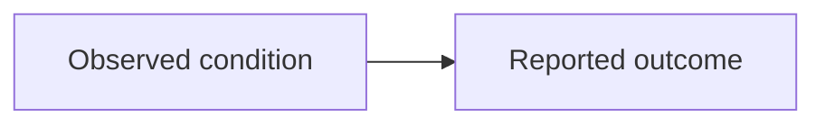

# Obsidian Markdown Reference

Use portable Markdown and document-relative local links. Resolve every relative
link from the file that contains it, and include `.md` in page-link filenames.

## Page and Image Links

From `wiki/index.md`:

```markdown
[Example concept](topics/example-concept.md)
```

From `wiki/sources/example-source.md`:

```markdown
[Example concept](../topics/example-concept.md)
[Example entity](../entities/example-entity.md)
```

Use descriptive link text and alt text. Keep media paths relative to the linking
document rather than the vault or a website root.

```markdown
<!-- From wiki/topics/example-topic.md -->

```

Check links again after moving or renaming pages or media.

## Headings, Emphasis, and Lists

```markdown
# Page title

## Section

### Subsection

**Strong emphasis** and *emphasis*.

- Unordered item
- Another item

1. First step
2. Second step
```

Use one page-level title and a consistent heading hierarchy. Do not use
formatting alone to convey a claim's source or certainty.

## Blockquotes

```markdown
> A verbatim quotation or clearly marked excerpt.
```

Attribute quotations with an inline citation or footnote outside the quotation.

## Tables

```markdown
| Criterion | Item A | Item B |
| --- | --- | --- |
| Scope | Source-supported detail | Source-supported detail |
| Limitation | Source-supported detail | Source-supported detail |
```

Preserve source tables when practical. Escape literal pipe characters inside
cells, and use a linked image when a complex layout cannot be represented
faithfully as Markdown.

## Code Blocks

Use fenced code blocks with an optional language identifier.

````markdown
```text
Preserve exact spacing, pseudocode, or other preformatted material here.
```
````

## Task Lists

```markdown
- [x] Extract source text
- [ ] Verify citations
- [ ] Check local links
```

## Footnotes

```markdown
A source-supported statement.[^1]

[^1]: Complete citation with a page, section, or timestamp when available.
```

Keep footnote labels unique within a document. Never invent missing citation
details.

## Callouts

Use an Obsidian warning callout when sources conflict. Present each position
with attribution rather than silently choosing one.

```markdown
> [!warning]
> Source A reports one value, while Source B reports another. The discrepancy
> remains unresolved; see the linked source pages and locators.
```

## Optional Mermaid Diagrams

Obsidian can render Mermaid diagrams. Use them only when a diagram clarifies
relationships supported by the sources.

````markdown

````

Keep important source claims and citations in text so the page remains useful
when diagrams are not rendered.

## Optional LaTeX Math

Obsidian supports LaTeX math through MathJax. Use it only for notation present
in, or directly supported by, the source material.

```markdown
Inline notation: $y = mx + b$

Display notation:

$$
\sum_{i=1}^{n} x_i
$$
```

Define symbols in surrounding text and retain the relevant source locator.
